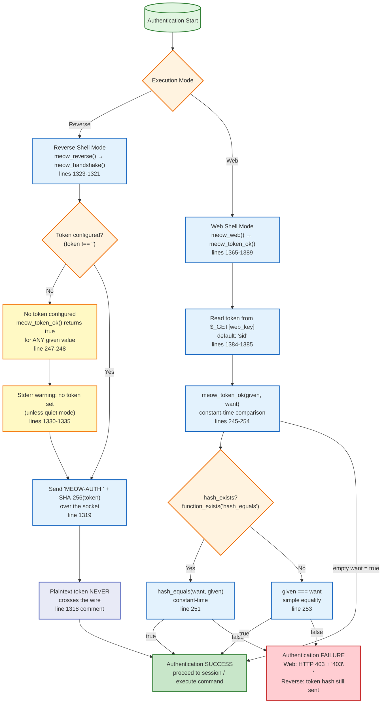

# Diagram 3 — Authentication Flow

## Mermaid Diagram

## Explanation of Major Nodes

| Node | Responsibility | Source Reference |
|------|---------------|------------------|
| **Mode Check** | Determines whether authentication happens via reverse-shell handshake or web token check | lines 1323-1411 |
| **Reverse Path** | `meow_handshake()` sends `MEOW-AUTH <sha256(token)>` after connection | lines 1314-1321 |
| **Web Path** | `meow_token_ok()` compares request parameter `$_GET[web_key]` against configured token | lines 1384-1385, 245-254 |
| **Token Set Check** | If token is empty (`''`), authentication is effectively disabled | line 1330 |
| **Send Hash** | Only the SHA-256 hash of the token is transmitted; plaintext never crosses the wire | line 1319 |
| **Token Compare** | `meow_token_ok()` uses `hash_equals()` when available, falls back to `===` | lines 245-254 |
| **No Token** | When `want === ''`, `meow_token_ok()` returns `true` for any `given` value | lines 247-248 |
| **Stderr Warning** | Warning emitted to STDERR when no token and not quiet | lines 1330-1335 |
| **Auth Success** | Reverse: session proceeds. Web: command execution proceeds. | — |
| **Auth Fail** | Web: HTTP 403 response with `403\n`. Reverse: hash still sent (listener decides). | lines 1386-1388 |

## Important Relationships

1. **Two independent auth paths**: Reverse shell sends hash after connecting; web mode compares request param before executing.
2. **Hash only**: The reverse-shell path never transmits the plaintext token — only its SHA-256 hash.
3. **Empty token = no auth**: `meow_token_ok()` short-circuits to `true` when the configured token is empty.
4. **Constant-time comparison**: Uses `hash_equals()` when available to mitigate timing attacks; falls back to `===`.
5. **Web 403 on failure**: Web mode returns HTTP 403 with `403\n` body when token check fails.

## Source-Code References

- Reverse handshake: lines 1314-1321
- Web token check: lines 1384-1389
- Token comparison: lines 245-254
- Empty token short-circuit: lines 247-248
- No-token warning: lines 1330-1335
- Web 403 response: lines 1386-1388

## Security Observations

- **Single shared secret**: One token for all sessions; no per-session or per-user authentication.
- **No replay protection**: The SHA-256 hash is static; an observer who captures it can replay it to authenticate.
- **No mutual authentication**: The shell authenticates to the listener, but the listener does not authenticate to the shell.
- **TLS does not verify peer**: Even with TLS enabled, `verify_peer => false` means the listener's identity is not confirmed.
- **Empty token risk**: If no token is set, anyone who can reach the callback host:port can drive the shell.
- **Stderr warning may leak**: The no-token warning is written to STDERR which may be captured in logs.

## Known Limitations and Uncertainties

- `hash_equals()` availability depends on PHP version (PHP 5.6+).
- Web mode only checks `$_GET[web_key]` for the token; `$_POST` is not checked for the token parameter.
- No rate limiting or lockout on failed authentication attempts.
- No nonce, challenge-response, or binding to a specific connection/session.
