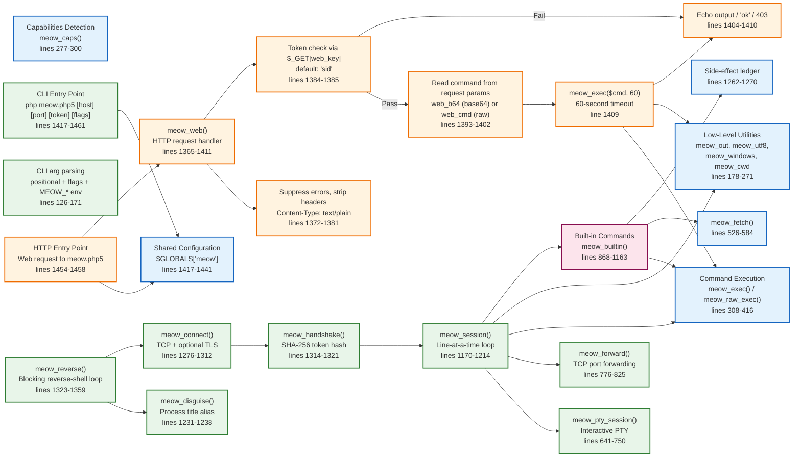

# Diagram 4 — CLI vs HTTP Architecture

## Mermaid Diagram

## Explanation of Major Nodes

### Shared Components

| Component | Responsibility | Source Reference |
|-----------|---------------|------------------|
| **Configuration** | `$GLOBALS['meow']` config array with all runtime settings | lines 1417-1441 |
| **Capabilities Detection** | Detects available command execution primitives | lines 277-300 |
| **Command Execution** | `meow_exec()` / `meow_raw_exec()` — tries primitives in order with optional timeout | lines 308-416 |
| **Low-Level Utilities** | `meow_out`, `meow_utf8`, `meow_windows`, `meow_cwd` | lines 178-271 |
| **Built-in Commands** | `meow_builtin()` — dispatches `!` commands | lines 868-1163 |
| **Remote Fetch** | `meow_fetch()` — retrieves remote files | lines 526-584 |
| **Side-Effect Ledger** | `meow_note()` / `meow_effects()` — tracks writes and forwards | lines 1262-1270 |

### CLI Mode (Reverse Shell)

| Component | Responsibility | Source Reference |
|-----------|---------------|------------------|
| **CLI Entry** | Invoked via `php meow.php5 [host] [port] [token] [flags]` | lines 1417-1461 |
| **CLI Config Parsing** | Positional args + flags + `MEOW_*` env overrides | lines 126-171 |
| **Reverse Mode** | `meow_reverse()` — blocking loop with reconnection | lines 1323-1359 |
| **Connect** | `meow_connect()` — TCP/TLS to remote listener | lines 1276-1312 |
| **Handshake** | `meow_handshake()` — SHA-256 token hash | lines 1314-1321 |
| **Session** | `meow_session()` — interactive line-at-a-time loop | lines 1170-1214 |
| **PTY** | `meow_pty_session()` — interactive pseudo-terminal | lines 641-750 |
| **Port Forwarding** | `meow_forward()` — detached TCP relay | lines 776-825 |
| **Disguise** | `meow_disguise()` — process title alias | lines 1231-1238 |

### HTTP Mode (Web Shell)

| Component | Responsibility | Source Reference |
|-----------|---------------|------------------|
| **HTTP Entry** | Web request to `meow.php5` | lines 1454-1458 |
| **Web Mode** | `meow_web()` — HTTP request handler | lines 1365-1411 |
| **Headers** | Suppresses errors, removes `X-Powered-By`, sets content type | lines 1372-1381 |
| **Token Check** | Validates `$_GET[web_key]` against configured token | lines 1384-1385 |
| **Command Read** | Reads `web_b64` (base64) or `web_cmd` (raw) from POST/GET | lines 1393-1402 |
| **Execute** | `meow_exec($cmd, 60)` with 60-second timeout | line 1409 |
| **Response** | Echoes output, `ok`, or `403` | lines 1404-1410 |

## Important Relationships

1. **Shared config**: Both modes read from the same `$GLOBALS['meow']` configuration array.
2. **Shared execution**: Both modes ultimately route command execution through `meow_exec()` / `meow_raw_exec()`.
3. **CLI is persistent**: The reverse-shell loop continues until manually stopped or retry limits are reached.
4. **HTTP is stateless**: Each request is handled independently; no persistent connection or session state.
5. **CLI has PTY and forwarding**: These features are only available in CLI/reverse mode, not HTTP mode.
6. **Web mode has its own timeout**: Hardcoded 60-second timeout for command execution (line 1409).

## Source-Code References

- Config defaults: lines 1417-1441
- CLI arg parsing: lines 126-171
- Entry dispatch: lines 1454-1461
- Web mode: lines 1365-1411
- Reverse mode: lines 1323-1359
- Connect: lines 1276-1312
- Handshake: lines 1314-1321
- Session: lines 1170-1214
- PTY session: lines 641-750
- Port forwarding: lines 776-825
- Disguise: lines 1231-1238
- Built-ins: lines 868-1163
- Fetch: lines 526-584
- Ledger: lines 1262-1270
- Command execution: lines 308-416

## Security Observations

- **Web mode suppresses errors**: `display_errors=0`, `log_errors=0` — prevents information leakage via error messages.
- **Web mode strips headers**: Removes `X-Powered-By` to avoid identifying the PHP interpreter.
- **Web mode token via GET only**: Token is checked only in `$_GET[web_key]`, not in POST body.
- **CLI has no HTTP exposure**: No web server needed; connects outbound to a listener.
- **Web mode 60-second timeout**: Hardcoded timeout may allow long-running commands to complete.
- **CLI reconnect loop**: Default retry forever (`retry_max = 0`) increases exposure window.

## Known Limitations and Uncertainties

- Web mode does not support HTTPS termination itself; relies on the web server for TLS.
- CLI mode requires outbound network connectivity to the listener.
- Web mode parameter names (`sid`, `upd`, `c`) can be renamed but defaults are predictable.
- No session persistence in web mode; each request is independent.
