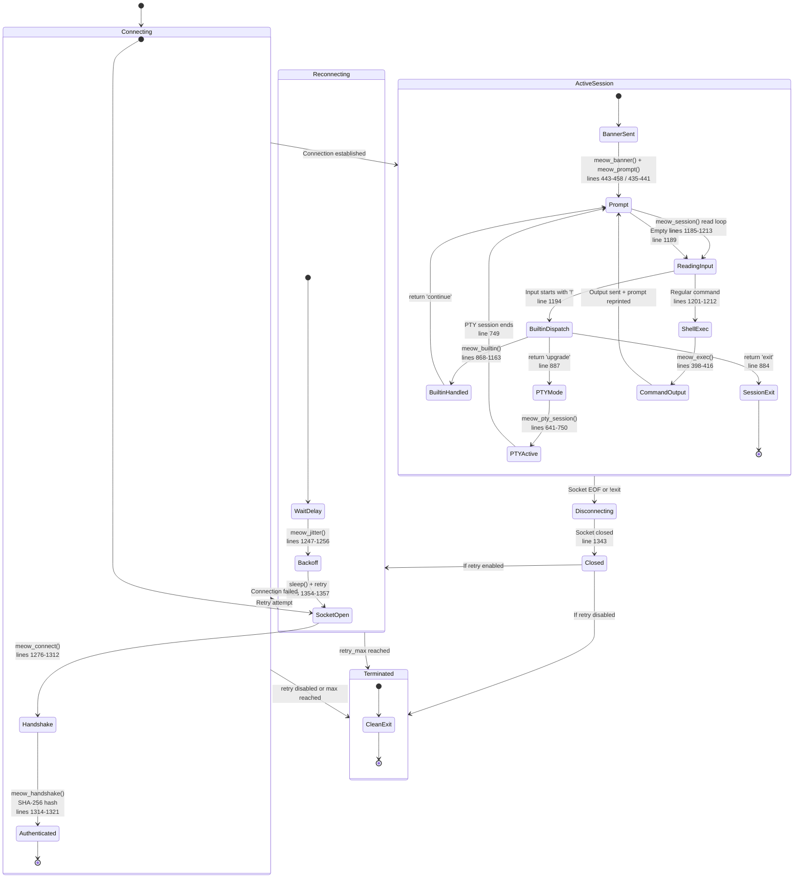

# Diagram 5 — Session Lifecycle

## Mermaid Diagram

## Explanation of Major States

| State | Description | Source Reference |
|-------|-------------|------------------|
| **Connecting** | Composite state: socket open → handshake → authenticated | lines 1276-1321 |
| **SocketOpen** | `meow_connect()` opens TCP/TLS stream to host:port | lines 1276-1312 |
| **Authenticated** | `meow_handshake()` sends `MEOW-AUTH <sha256(token)>` | lines 1314-1321 |
| **ActiveSession** | Composite state: interactive command loop | lines 1170-1214 |
| **BannerSent** | `meow_banner()` prints version/info banner | lines 443-458 |
| **Prompt** | `meow_prompt()` prints ANSI-colored prompt | lines 435-441 |
| **ReadingInput** | `fgets()` reads line from socket (8192 byte buffer) | line 1186 |
| **BuiltinDispatch** | `!` commands routed to `meow_builtin()` | line 1194 |
| **ShellExec** | Non-built-in input executed via `meow_exec()` | lines 1201-1212 |
| **PTYMode** | `meow_pty_session()` — interactive pseudo-terminal | lines 641-750 |
| **SessionExit** | `!exit` returns 'exit', ending the session | line 884 |
| **Disconnecting** | Socket EOF or `!exit` ends session | lines 1195-1196, 1213 |
| **Reconnecting** | Exponential backoff with jitter before reconnect | lines 1354-1357 |
| **Terminated** | Session ends; no further reconnection | lines 1347-1352 |

## Important Transitions

1. **Connecting → ActiveSession**: Occurs after successful TCP/TLS connection and handshake.
2. **ActiveSession → Reconnecting**: Occurs on socket EOF when retry is enabled.
3. **ReadingInput → BuiltinDispatch**: Input line starts with `!` (but not `!!`).
4. **ReadingInput → ShellExec**: Any other input is executed as a shell command.
5. **BuiltinDispatch → PTYMode**: `!upgrade` returns 'upgrade'.
6. **BuiltinDispatch → SessionExit**: `!exit` returns 'exit'.
7. **PTYMode → Prompt**: PTY session ends (socket EOF or child process EOF), returns to line-at-a-time mode.
8. **ActiveSession → Disconnecting**: Socket EOF (`feof`) or `!exit`.
9. **Reconnecting → Terminated**: `retry_max` reached or retry disabled.

## Source-Code References

- Connect: lines 1276-1312
- Handshake: lines 1314-1321
- Session loop: lines 1170-1214
- Banner: lines 443-458
- Prompt: lines 435-441
- Built-in dispatch: lines 868-1163
- PTY session: lines 641-750
- Command execution: lines 398-416
- Reverse/reconnect: lines 1323-1359
- Jitter: lines 1247-1256

## Security Observations

- **No session timeout**: The session has no idle timeout; it persists until socket EOF or `!exit`.
- **Reconnect forever**: Default `retry_max = 0` means reconnection attempts continue indefinitely.
- **PTY byte-for-byte**: Terminal control sequences pass through unfiltered in PTY mode.
- **Command exit codes**: Non-zero exit codes are reported (`[exit %d]`) but do not terminate the session.
- **Empty lines**: Reprint the prompt without executing anything (line 1189-1191).

## Known Limitations and Uncertainties

- `stream_select()` timeout of 5 seconds in PTY mode (line 686).
- Socket read buffer is 8192 bytes (line 1186); longer lines may be split.
- No authentication re-validation during an active session.
- PTY mode on Windows is explicitly unsupported (line 643).
