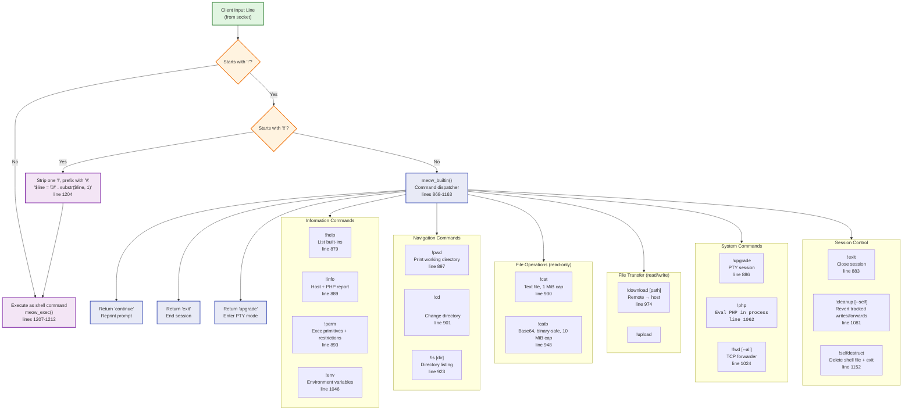

# Diagram 6 — Internal Command Architecture

## Mermaid Diagram

## Explanation of Major Nodes

| Node | Responsibility | Source Reference |
|------|---------------|------------------|
| **Input** | Raw line read from socket via `fgets($sock, 8192)` | line 1186 |
| **IsBang** | Decision: does line start with `!`? | line 1194 |
| **IsDoubleBang** | Decision: does line start with `!!`? | line 1201 |
| **ShellExec** | Regular command executed via `meow_exec()` | lines 1207-1212 |
| **DoubleBangEscaped** | `!!<cmd>` → `\<cmd>` so `!` reaches shell literally | line 1204 |
| **BuiltinDispatch** | `meow_builtin()` parses and dispatches `!` commands | lines 868-1163 |

### Command Categories

**Information Commands** (read-only host/PHP reconnaissance):
- `!help` — lists all built-in commands (line 879)
- `!info` — host + PHP capability report (line 889)
- `!perm` — exec primitives, `disable_functions`, `open_basedir` (line 893)
- `!env` — dumps `$_SERVER`, `$_ENV`, and `env` command output (line 1046)

**Navigation Commands** (working directory):
- `!pwd` — prints current working directory (line 897)
- `!cd <dir>` — changes cwd; no arg resets to default (line 901)
- `!ls [dir]` — runs `ls -la` with 15-second timeout (line 923)

**File Operations** (read-only):
- `!cat <file>` — prints text file, 1 MiB cap, suggests `!catb` for larger (line 930)
- `!catb <file>` — base64-encoded binary-safe read, 10 MiB cap (line 948)

**File Transfer** (read/write):
- `!download <url> [path]` — fetches remote file via `meow_fetch()`, writes via `file_put_contents()`, tracked in ledger (line 974)
- `!upload <path>` — receives base64 lines terminated by `.`, 50 MiB ceiling, strict base64 decode, tracked in ledger (line 996)

**System Commands**:
- `!upgrade` — enters interactive PTY session (line 886)
- `!php <code>` — `eval($code . ';')` with output buffering and exception handling (line 1062)
- `!fwd [--all] <lport> <rhost> <rport>` — forked TCP port forwarder via `pcntl_fork` (line 1024)

**Session Control**:
- `!exit` — returns 'exit', ending the session (line 883)
- `!cleanup [--self]` — unlinks tracked files, kills tracked forwards, resets cwd; `--self` also deletes shell file (line 1081)
- `!selfdestruct` — deletes shell file and exits (line 1152)

## Dispatch Return Values

| Return | Meaning | Source |
|--------|---------|--------|
| `'continue'` | Command handled, reprint prompt | lines 881, 891, 895, 899, 921, 928, 946, 972, 994, 1022, 1044, 1079, 1149, 1162 |
| `'exit'` | End the session | line 884 |
| `'upgrade'` | Enter PTY mode | line 887 |

## Source-Code References

- Input reading: line 1186
- Bang detection: line 1194
- Double-bang handling: lines 1201-1204
- Shell execution: lines 1207-1212
- Built-in dispatcher: lines 868-1163
- Individual commands: lines 879-1159 (see above table)

## Security Observations

- **`!php <code>`**: Arbitrary PHP evaluation with full process privileges — highest risk command.
- **`!download`/`!upload`**: Arbitrary file write capability, subject to `open_basedir` and filesystem permissions.
- **`!cat`/`!catb`**: Arbitrary file read capability, subject to `open_basedir` and filesystem permissions.
- **`!fwd`**: Can expose internal network services via `--all` (binds to 0.0.0.0).
- **`!selfdestruct`/`!cleanup --self`**: Irreversible self-deletion of the shell file.
- **No command filtering**: Any shell command can be executed; no allowlist/denylist beyond `disable_functions`.
- **`!!<cmd>` escape**: Allows `!` as a literal shell command name, bypassing built-in dispatch.

## Known Limitations and Uncertainties

- `!cat` refuses files >1 MiB; `!catb` refuses >10 MiB; `!upload` caps base64 input at 50 MiB.
- `!download` URL validation requires `FILTER_VALIDATE_URL` or `http` prefix.
- `!fwd` requires `pcntl_fork`; unavailable without the `pcntl` extension.
- `!upgrade` unavailable on Windows.
- File size caps are hardcoded constants (1 MiB, 10 MiB, 50 MiB).
- `!php` eval has no sandbox; exceptions are caught but the process continues.
