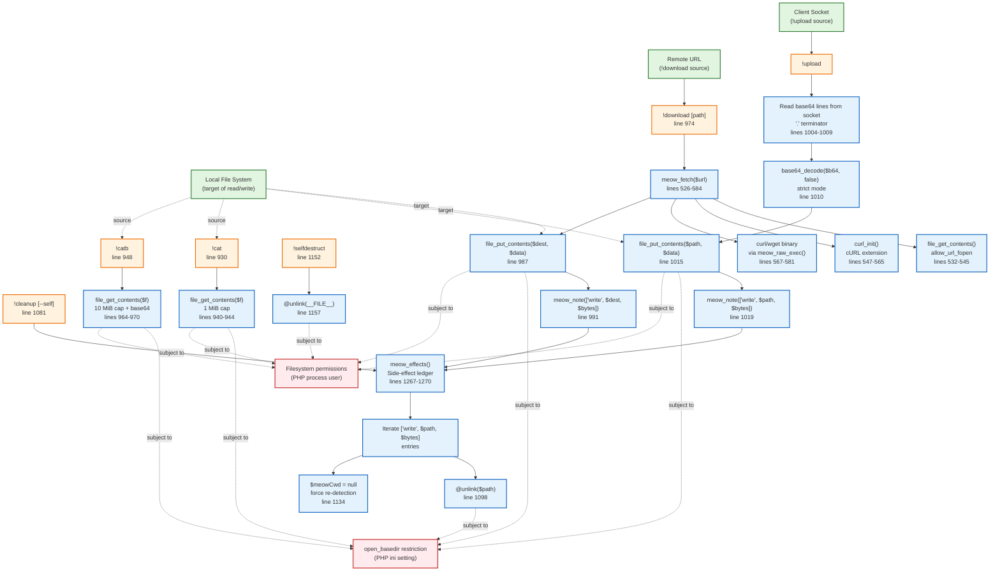

# Diagram 7 — File Management Architecture

## Mermaid Diagram

## Explanation of Major Nodes

| Node | Responsibility | Source Reference |
|------|---------------|------------------|
| **!download** | Fetches remote URL and writes to local path; records in ledger | line 974 |
| **!upload** | Receives base64 from socket, decodes, writes to local path; records in ledger | line 996 |
| **!cat** | Reads and prints text file (1 MiB cap) | line 930 |
| **!catb** | Reads and base64-encodes file (10 MiB cap, binary-safe) | line 948 |
| **!cleanup** | Unlinks tracked files, kills tracked forwards, resets cwd | line 1081 |
| **!selfdestruct** | Deletes shell file and exits | line 1152 |
| **meow_fetch()** | Retrieves remote content via URL fopen, cURL, or curl/wget binary | lines 526-584 |
| **file_put_contents()** | Writes data to local file (used by download/upload) | lines 987, 1015 |
| **base64_decode()** | Strict base64 decoding for upload (line 1010) | line 1010 |
| **meow_note()** | Records `['write', $path, $bytes]` in side-effect ledger | lines 991, 1019, 1262-1265 |
| **meow_effects()** | Returns all tracked side effects for cleanup | lines 1267-1270 |
| **@unlink()** | Deletes file during cleanup or self-destruct | lines 1098, 1157 |

## File Size Caps

| Command | Cap | Behavior at cap | Source |
|---------|-----|-----------------|--------|
| `!cat` | 1 MiB (1,048,576 bytes) | Suggests `!catb`; refuses to print | line 940-942 |
| `!catb` | 10 MiB (10,485,760 bytes) | Suggests `!download`; refuses to read | line 960-962 |
| `!upload` | 50 MiB base64 input | Breaks reading loop | line 1008 |

## Ledger Entries

| Entry Type | Format | Recorded By |
|------------|--------|-------------|
| File write | `['write', $path, $bytes]` | `!download` (line 991), `!upload` (line 1019) |
| Port forward | `['fwd', $pid, $bind, $lport, $rhost, $rport]` | `!fwd` → `meow_forward()` (line 789) |

## Access Boundaries

| Boundary | Description | Enforced By |
|----------|-------------|-------------|
| **`open_basedir`** | PHP ini setting restricting file access paths | PHP engine (checked implicitly by `file_get_contents`, `file_put_contents`, `unlink`) |
| **Filesystem permissions** | PHP process user's read/write/unlink permissions | OS filesystem |

## Important Relationships

1. **Download → Fetch → Write → Ledger**: Remote content is fetched, written to disk, and recorded for cleanup.
2. **Upload → Read → Decode → Write → Ledger**: Base64 is read from socket, decoded, written, and recorded.
3. **Read commands → Local file**: `!cat`/`!catb` read local files but do NOT record in ledger (read-only).
4. **Cleanup → Ledger → Unlink**: Only paths recorded by `!download`/`!upload` are eligible for cleanup.
5. **Self-destruct → Unlink(__FILE__)**: Independent of ledger; deletes the shell file itself.

## Source-Code References

- Download: lines 974-994
- Upload: lines 996-1022
- Cat: lines 930-946
- CatB: lines 948-972
- Fetch: lines 526-584
- Cleanup: lines 1081-1149
- Self-destruct: lines 1152-1159
- Ledger: lines 1262-1270

## Security Observations

- **Arbitrary file write**: `!download` and `!upload` can write any path the PHP process can write to, subject to `open_basedir`.
- **Arbitrary file read**: `!cat`/`!catb` can read any file the PHP process can read.
- **No path traversal guards**: Beyond `open_basedir`, no additional path sanitization is performed.
- **SSL verification disabled in fetch**: `verify_peer => false`, `allow_self_signed => true` — remote downloads are not authenticated.
- **Cleanup is ledger-limited**: Files written outside `!download`/`!upload` (e.g., shell redirects, temp files) are NOT tracked and will not be removed by `!cleanup`.
- **Self-deletion is irreversible**: `!selfdestruct` and `!cleanup --self` permanently remove the shell file.
- **Upload strict base64**: `base64_decode($b64, false)` with strict mode rejects malformed input.

## Known Limitations and Uncertainties

- `open_basedir` enforcement depends on PHP configuration; not enforced by the code itself.
- File size caps are hardcoded; no configuration option to adjust them.
- `!download` follows up to 5 redirects (line 534).
- `!fetch` timeout is 30 seconds (lines 534, 554).
- Cleanup does not verify file ownership before unlinking tracked paths.
