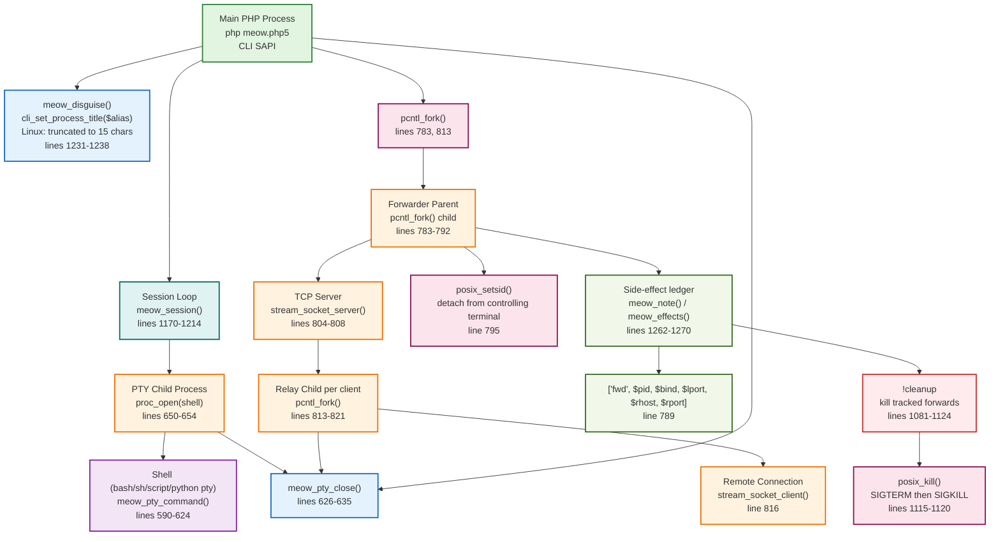

# Diagram 8 — Process Management

## Mermaid Diagram



## Explanation of Major Nodes

| Node | Responsibility | Source Reference |
|------|---------------|------------------|
| **Main PHP Process** | The `php meow.php5` process itself; runs the session loop | — |
| **Process Title** | `meow_disguise()` renames process via `cli_set_process_title()` (CLI only, 15-char limit) | lines 1231-1238 |
| **Session Loop** | `meow_session()` — blocking line-at-a-time command loop | lines 1170-1214 |
| **PTY Child** | Shell process spawned via `proc_open()` with pipes for stdin/stdout/stderr | lines 650-654 |
| **PTY Shell** | The actual shell binary (bash, sh, script, or python pty) | lines 590-624 |
| **Forwarder Parent** | `pcntl_fork()` child that persists after returning to session; binds TCP server | lines 783-792 |
| **TCP Server** | `stream_socket_server()` listening on bind:port (loopback by default) | lines 804-808 |
| **Relay Child** | Per-client `pcntl_fork()` grandchild that pumps bytes between local client and remote | lines 813-821 |
| **Remote Connection** | `stream_socket_client()` to target host:port | line 816 |
| **pcntl_fork()** | Process creation primitive; required for port forwarding | lines 783, 813 |
| **posix_setsid()** | Detaches forwarder child from controlling terminal | line 795 |
| **posix_kill()** | Sends SIGTERM then SIGKILL to tracked forwarder PIDs during cleanup | lines 1115-1120 |
| **proc_close()/proc_terminate()** | Closes and terminates PTY child process | lines 632-633, 745-746 |
| **meow_pump()** | Bidirectional byte pump between two streams using `stream_select()` | lines 756-773 |
| **Side-effect ledger** | Tracks `['fwd', $pid, ...]` entries for cleanup | lines 789, 1262-1270 |
| **Cleanup** | `!cleanup` iterates ledger, kills forwarder PIDs via `posix_kill()` | lines 1081-1124 |

## Process Hierarchy

```
Main PHP Process (php meow.php5)
├── PTY Child (proc_open)          [only when !upgrade]
│   └── Shell (bash/sh/etc.)
├── Forwarder Parent (pcntl_fork)   [only when !fwd]
│   ├── TCP Server (accept loop)
│   └── Relay Child (pcntl_fork)    [one per client]
│       ├── Local Client
│       └── Remote Connection
```

## Process Lifecycle

1. **Main process starts**: `php meow.php5` runs in CLI SAPI.
2. **Process title set**: `meow_disguise()` may rename the process (CLI only).
3. **Session loop**: `meow_session()` blocks on socket I/O.
4. **PTY spawn** (optional): `!upgrade` forks a shell via `proc_open()`; multiplexed with `stream_select()`.
5. **Port forward** (optional): `!fwd` forks a detached parent that binds a TCP server; each client connection forks a relay child.
6. **Cleanup**: `!cleanup` kills tracked forwarder PIDs via `posix_kill()` (SIGTERM, wait 150ms, SIGKILL if needed).
7. **Self-destruct** (optional): `!selfdestruct` or `!cleanup --self` deletes the shell file and exits.

## Source-Code References

- Process title: lines 1231-1238
- Session: lines 1170-1214
- PTY command: lines 608-624
- PTY session: lines 641-750
- PTY close: lines 626-635
- Port forwarding: lines 776-825
- Pump: lines 756-773
- Forwarder ledger entry: line 789
- Cleanup kill logic: lines 1115-1120
- Ledger: lines 1262-1270

## Security Observations

- **Detached forwarders**: Port forwarder children are fully detached (`posix_setsid`, closed stdio) and persist independently of the shell session.
- **Fork bomb potential**: `!fwd` can be called repeatedly, creating multiple persistent processes; no rate limiting.
- **No process limits**: No maximum on number of forwarders or PTY sessions.
- **Cleanup relies on PID validity**: `posix_kill($pid, 0)` checks aliveness; PID reuse could target wrong process.
- **Process title is cosmetic**: `cli_set_process_title()` is truncated to 15 characters on Linux; does not hide the process from determined inspection.
- **Windows limitations**: PTY unavailable on Windows; `pcntl_fork` unavailable (port forwarding disabled).

## Known Limitations and Uncertainties

- `pcntl_fork` requires the `pcntl` PHP extension; port forwarding is unavailable without it.
- `posix_setsid` and `posix_kill` require the `posix` extension.
- PTY upgrade unavailable on Windows (line 643).
- Forwarder parent binds to loopback (`127.0.0.1`) by default; `--all` binds to `0.0.0.0`.
- Relay child has a 15-second connection timeout to remote (line 816).
- Server accept timeout is 3600 seconds (line 811).
